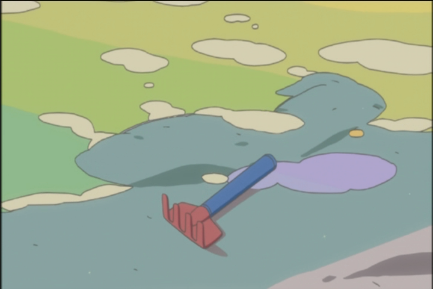
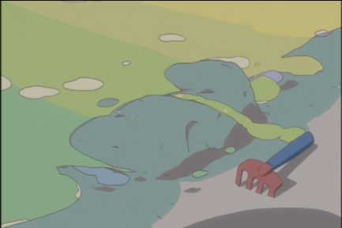
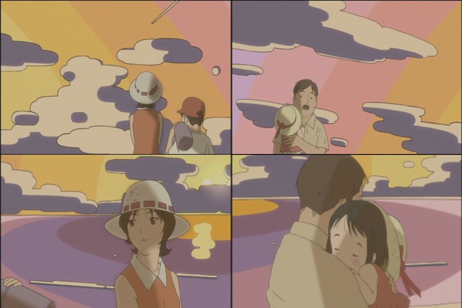

The original text is in Korean, and this translation was produced by ChatGPT.

Japanese animation in the Reiwa era has become highly standardized in its structure. An episode without ninety-second opening and ending sequences, or without a main body divided into two parts, is now a rarity. Even departures from the pattern, such as omitting the opening or ending in some episodes, have become clichés of their own. The particular images that appear in these openings and endings, too, are commonly thought to be clichés. If one searches YouTube and the like for “anime opening clichés,” “アニメOPあるある,” or “anime openings be like,” one can easily find videos parodying such images. In other words, viewers of Japanese animation treat its openings/endings as “predictable,” as videos that can be skipped without consequence. Yet at the same time, the opening and ending of Japanese animation are clearly sites of experimentation in animation ― places where great animators gather. The free overlapping of several layers of entirely unrelated images, or rhythm drawn through the motion of geometric figures, that is, so-called abstract animation, finds its licence to exist only there, in that special position within the world of Japanese animation. That special position lies somewhere between animation and visual design, between an independent music video and an opening/ending subordinated to a series.  

https://youtu.be/TR3ma_60-m4

*The opening animation of 『Steins;Gate』. It moves rapidly among images deliberately superimposed through multiple exposures.*

https://youtu.be/_AVvkDDFD34

*The ending animation of 『Hidamari Sketch』. Geometric figures appear and move in time with the rhythm of the song, producing a visual rhythm. In addition, it creates a rotating space by contrasting a rapidly moving layer of background images with a still character, and through the outline of a bird that reproduces the stair-stepping of a bitmap image, it gives the feeling that the object has been further enlarged.*
  
The opening/ending of Japanese animation presents itself to us, on one side, as an assemblage of images that appear clichéd, and, on the other side, as a site of experimentation in animation. Yet why, despite constant experiment, are opening/ending animations so readily dismissed by viewers? Why do even those who criticize people who watch animation at faster playback speeds to save time skip the one-minute-and-thirty-second opening/ending animation?
{: .no-indent}

To answer this question, I will approach the role of opening and ending sequences in anime series through an analogy. Using that analogy as a foothold, our aim is to discuss in what sense the ending animation of 『Koi Kaze』 was able to become an “ending that cannot be skipped,” and how it transforms endings in general into “things that cannot be skipped.” Thus, I will not conduct a survey of the state of openings/endings and scold either the image or the viewer as the one at fault.

## Opening/Ending Animation as a “Frame of Time”
In addition to the two opposed aspects described above, opening/ending animation has a practical purpose insofar as it is the opening and ending of a TV anime. Rather, this function is probably the fundamental material property of opening/ending animation. That is, it informs television viewers that the anime is about to begin, or that the anime has just ended and they can safely change the channel. Therefore, the opening stops viewers wandering across TV channels in their tracks, gives those who have hurried to switch on the television ninety seconds to settle in, and gathers scattered gazes into one place. Conversely, the ending opens the hand that had held those gazes and lets them disperse.

Yet on the other side, the opening announces that the rain of commercials has stopped and the anime has just begun, while the ending announces that the anime will soon end and enter the commercials. In short, the opening/ending belongs not to commercials, not to fragmentary information on the screen, and not to the previous or next episode, but to that very episode of that anime; at the same time, within that anime itself, it is expelled outside the main body and reduced to a signal that notifies us of the beginning and end of the main body.

Denied a place both within the episode proper and among the commercials outside it, the opening/ending is better understood as a frame. More specifically, since it shares time’s asymmetry, as we have seen, it is a frame of time. The frame is “neither the work nor outside the work, neither inside nor outside, neither above nor below”[^1]. In other words, the frame ― whether visible or invisible ― is an element internal to the work in relation to the external wall, and is external to the painting within it. At the same time, as a frame, it delimits the area of the picture it surrounds. Around the painting, the frame makes the decisive determination that allows us to count that painting as one. When not the painting but the frame draws the boundary of the painting, the boundary of the painting itself is not there. Without a relation to the frame, the painting cannot be delimited as that painting. Therefore, it is not that the frame needs the picture, but rather that the picture itself needs the frame. It is in this context that, in episodes 4, 6, and 9 of 『Hidamari Sketch ×365』, the ending and opening are additionally inserted between the temporally separated A and B parts instead of an eyecatch. Here, the ending and opening are signs that establish the boundaries of each part. They cut the connection between the A part and B part, which might in some sense be called a montage, and make each part into an independent “episode.”

But at this point the painting extends in the direction of the frame. When the painting, unable to delimit its own boundary by itself, calls for a frame, the frame artificially defines the picture as a single object while becoming inseparable from it. Thus the boundary of the painting inside the frame disperses as the painting demands that the frame participate in the picture. Or, the contour of the painting indicated by the frame is sucked into the picture together with the frame as that very frame supplements the painting. Now the frame, within the picture, draws what the painting could not draw, and thereby produces a new meaning for that painting. As an “extended region of signification”[^2]. It is in this sense that an opening or ending that cannot be skipped first becomes possible.

## Preparatory Work ─ On the TV Anime 『Koi Kaze』
Before discussing the ending animation of 『Koi Kaze』, I will first examine the criticism of 『Koi Kaze』 by the independent critic 異邦人 (Ibangin), “A Comparison of the Anime Koi Kaze (恋風) and the Manga Koi Kaze”[^3]. He also wrote five other amateur but meticulous essays on the manga 『Koi Kaze』. Perhaps this entire project may be read as a metacriticism of Ibangin.

For Ibangin, the manga 『Koi Kaze』 is filled with symbolic signs. For Ibangin, cherry blossoms are the beginning and end of 『Koi Kaze』, the growth between them, the place where Koshiro confesses his feelings, and the place of healing for Koshiro and Nanoka. At the center of all these cherry blossoms there is always Nanoka. For him, Nanoka is the cherry blossom, that is, transcendent flawlessness and pure femininity. For Ibangin, Koshiro is a figure who encounters Nanoka as cherry blossom and discovers sincere, tender feelings. Therefore, for him, the cherry blossom cannot help but become the center of the meaning of 『Koi Kaze』. The three springs in which cherry blossoms bloom in 『Koi Kaze』 are changes or developments in Koshiro’s feelings. Ibangin argues that the three springs respectively signify the developmental stages of a beginning as simple recognition, separation and intense feeling, and the vow of eternal love, that is, beginning, end, and completion. For Ibangin, the second summer, moving toward completion—Koshiro and Nanoka’s journey to a shrine for binding relationships, and to the summer sea at sunrise—becomes a device suggesting that their feelings extend into the next life. For him, 『Koi Kaze』 is a manga that depicts the process in which a man is healed and grows ― in the Nietzschean sense ― within his relationship to cherry blossoms and Nanoka, and in which the transcendent and eternal feelings of the two are completed[^4].

Yet in Ibangin’s essay on the anime 『Koi Kaze』, “A Comparison of the Anime Koi Kaze (恋風) and the Manga Koi Kaze,” he was naive in at least two respects. First, Ibangin chose to read the anime 『Koi Kaze』 by comparing it to the manga 『Koi Kaze』. As in Ibangin’s case, judgments ostensibly directed at anime often address something else: the “original work,” accorded a privileged position. There, the anime “transcends” or “destroys” the original, but there is no hermeneutics for the anime. In short, whether the anime has “transcended” or “destroyed” the original, insofar as the claim is merely that it supplements or escapes from the aesthetic claims already attributed to the original, no new meaning for the anime text will be produced. At this point, the anime becomes merely a supplement added to the original. Especially when an element of the original is absent from the anime ― for example, since a pair of shoes depicted in Van Gogh’s painting may in fact be “two shoes each with a different mate, two shoes for the same foot, or one shoe and its ghost”[^5], that element can always be one symbol ― the anime is left seeming deficient in that symbol, deprived of meaning, and therefore incomplete. Thus, under so-called original-work centrism, the anime, because it cannot always reproduce the original’s meaning, not only cannot give birth to new thought but becomes a frame outside the original. When Azuma Kiyohiko wrote on his blog, “...explaining why I do not make it into an anime somehow feels like acknowledging the idea that manga is the ‘original work’ of anime, so as a manga artist I do not want to do it”[^6], he was rather expressing dissatisfaction with original-work centrism. For the moment when a manga becomes the original work of an anime, that is, when manga comes to bear the name “original work,” is the moment when one reads the anime with that manga at the center.

Therefore, when Ibangin thought that Koshiro is completed only through the three springs of cherry blossoms, and when he dogmatically took that as the truth meant by 『Koi Kaze』, he was already unable to tolerate any change the anime might make to 『Koi Kaze』. Thus, the anime 『Koi Kaze』, which figures Nanoka through muddy water rather than cherry blossoms, and which deletes the shrine trip and sunrise of the second summer, could only be understood by Ibangin as having castrated the purity and transcendence of the manga 『Koi Kaze』. When Ibangin wrote that Koshiro in episode 8 of the anime 『Koi Kaze』 “does not drink the muddy water and throws it away,” it was because, for him, the muddy water symbolized a difference from the original that was nothing but a superfluous appendage. Therefore, the muddy water had to be thrown away. Forgotten, meanwhile, is the sequence that cuts between the young Koshiro repeatedly putting off discarding the muddy water, and the older Koshiro recalling this memory with apparent amusement on his way home.

The other respect is this: when this otherwise meticulous critic read 『Koi Kaze』 as animation, he chose to skip its opening and ending—the very elements most specific to animation.

## The Ending Animation of 『Koi Kaze』 as an Unskippable Ending
The ending animation of 『Koi Kaze』[^7] is simple. The first ending, encountered as episode 1 draws to a close, can be bewildering. The outlines of three people walking leisurely along a sandy beach are shown, waves come in, ... and that is all. We do not know where or when this walk along the sea takes place. We do not even know who these three people are.

https://youtu.be/kxnG9dawYcg

*The ending animation of 『Koi Kaze』. From episode 1 to episode 8, the ending consists entirely of a scene in which three people walk along the seashore.*
  
They walk on a single layer. Backlighting from the sun (sunrise? or sunset?) strips them of depth. For that matter, are they even walking forward? Only the waves surging out toward us, slightly to the left, indicate their forward movement. In reality, only the camera ― if there is anything that can be called a camera in animation ― edges forward in the direction of their walk. On the other hand, the deliberately designed colors and the peculiar forms of the clouds and waves seem to separate the main episode from the ending. The ending of 『Koi Kaze』 is an empty ending set apart: anonymous space and time, anonymous figures, an ambiguous direction.
{: .no-indent}

Here, the ending animation of 『Koi Kaze』 seems to form an opposed pair with 『Koi Kaze』. Whether one likes it or not, 『Koi Kaze』 is problematic... yet it still seems to be composed in a classical, non-experimental manner. In the scene where Koshiro and Nanoka first meet, 『Koi Kaze』 alternately places close-ups of Nanoka and Koshiro, while inserting cherry blossoms that cut across these divisions. The impression Nanoka leaves is carried through the cherry blossoms. Even after Koshiro is left alone, it makes us imagine the space on the other side of the screen, toward which he looks. Whether in the manga 『Koi Kaze』 or the anime 『Koi Kaze』, the reader will discover the impression of metaphor within it, and this discovery itself is immanent to 『Koi Kaze』. In this sense, Ibangin is a faithful reader of 『Koi Kaze』, and the metaphor he revealed in 『Koi Kaze』 is also a simile. Yet the anime 『Koi Kaze』, as discussed above, is extended in the direction of the ending. At the same time, the ending animation of 『Koi Kaze』 as an empty ending halts this discovery of figuration and delays it for one minute and thirty seconds. The extended region of signification is emptied out, and a hole opens somewhere within 『Koi Kaze』, which is filled with symbols. As though all the signs of 『Koi Kaze』 break together with the waves, one of the protagonists of the ending ― for what can be seen there are only waves and figures.

Let us note that this operates in parallel upon the manga and the anime 『Koi Kaze』. Then the ending animation of 『Koi Kaze』 is also the sublation of original-work centrism itself. When, under original-work centrism, the anime 『Koi Kaze』 becomes the supplement of the original, the ending of 『Koi Kaze』 stops the signification continuing from the original. Then it inserts there the virus of a one-minute-and-thirty-second empty space. At this moment, the anime 『Koi Kaze』 conversely changes the meaning of the original. Original-work centrism applied to 『Koi Kaze』 comes, at this point, to negate itself.

Yet 『Koi Kaze』 does not stop here. When Nanoka confesses her love to Koshiro, the ending animation of 『Koi Kaze』 changes: a short close-up is added, of one part of the sea where a sand spade drifts away, where the sandcastle made with that shovel has left scarcely a trace. Since the sandcastle and shovel are entirely new objects, we seem to be elsewhere along the sea, and thus this insertion looks somewhat random. Yet the sameness of the sea guaranteed by the connection between the two scenes, and the trace of the sandcastle shown in close-up in the added scene, indirectly present a small narrative. The three people in the ending, no, the four people ― the intimate relation between 『Koi Kaze』 and its ending demands that the figures in the ending be the protagonists of 『Koi Kaze』. One episode before the ending changes, Koshiro’s recollection reveals that the young Koshiro and Nanoka are in the ending. At the same time, the ending repeated steadily from the first episode in turn lends legitimacy to that flashback. Without presenting any marker in the ending, the change in 『Koi Kaze』 suggests who those figures are. ― had been playing together at the sea, making a sandcastle, and are now returning home as the sun sets. The sandcastle left behind collapses, washed away by the waves together with the shovel.

{: .half}

*A frame from the final shot of the ending sequence used from episode 9 of 『Koi Kaze』 through the finale.*

Nanoka’s confession fails because of Koshiro’s conscious recoil from an incestuous relationship. Nanoka tries to run out of the room, but in that short interval Koshiro grabs Nanoka’s arm and embraces her. Nanoka shakes Koshiro off and leaves the room. At this moment, both clearly expressed a desire to reach the other. Yet these feelings do not reach the one they should reach. And the ending begins. And.... Thus 『Koi Kaze』 creates a strange connection between this undelivered confession and the trace of the sandcastle.

In the next episode, Koshiro does not meet Nanoka, who left home early in the morning. To annul the embrace-of-Nanoka that failed to reach her, Koshiro resolves to leave home. The screen then shows Nanoka puzzling over the gap between her failed confession and his baffling embrace, then Koshiro looking for a place to live, then Nanoka going to a friend’s house because she does not want to go home. A little later, when Koshiro returns home and tries to tell his father that he will leave the house, the phone rings. In this call from Nanoka, Koshiro and Nanoka realize together that there had been some delivery error in that confession which did not arrive. Nanoka returns home earlier than planned. Yet Koshiro is already bound by the contract for his new place. The two are together again, but the confession that failed to arrive does not simply reach its destination this time. Yet: “There’s something I haven’t been able to tell you all this time. Do you remember? When we were on the Ferris wheel. (...) Back then, I was really happy. So if things went on like this, I...” Koshiro and Nanoka hold hands. Clearly, through the connected phone line and their joined hands, the confession that had failed to arrive has changed. But because of the two people’s different definitions of siblings[^8], the success of the confession is delayed and the delivery error is repeated.

In the morning, Nanoka wakes alone. The ending begins entwined with Koshiro packing his belongings and opening the door, and with the sunlight streaming in. The ending begins with traces of a sandcastle different from the previous one. The sandcastle still retains a certain degree of form, and the sand spade is stuck in the sand. Still, the waves wash away the sandcastle. It appears closer to an intact sandcastle, but still is not a sandcastle. 『Koi Kaze』 continues subtly to connect confessions that failed to arrive and traces of sandcastles.

{: .half}

*A frame from the final shot of the ending sequence used from episode 10 of 『Koi Kaze』 through the finale.*

At the same time, this ending directly reveals the figures in the ending, whose identities had until now been kept from explicit view. The young Koshiro and his mother, and the father holding Nanoka. This revealed fact no longer seems very surprising, but on the other hand, something still remains unrevealed. Are the four truly together, especially the mother-Koshiro pair and the father-Nanoka pair? In the second shot of the ending, which shows three people walking together, they are still anonymous. Conversely, from the third to the sixth shot, though their identities are clear, they are not together. They are connected only by gazes. Rather, the ending places the divorced mother and father, and Koshiro and Nanoka, as opposed pairs.

{: .half}

*Frames from the third through sixth shots of the ending used from episode 10 of 『Koi Kaze』 through the finale [^9].*
  
Without resolving the opposition, the ending shows again the trace of the first sandcastle. Koshiro and Nanoka still do not reach each other. The subtle connection seen above is now embedded deep within the ending itself.
{: .no-indent}

Koshiro moves out, and Nanoka secretly leaves a handmade sweater in front of the door of Koshiro’s house. Koshiro happens to see her and tries to hide with his coworker Chidori; in doing so, he gives away his feelings for Nanoka. Chidori despises Koshiro, and Koshiro shuts himself in his room and becomes a wreck. Koshiro, at a loss, is about to go out to buy tissues when he meets Nanoka, who has secretly come to his house to deliver oranges. And... one thing leads to another... the two spend the night together (ending), travel to their mother’s house, and even think of a double suicide at a pier where entry is prohibited.... On the other hand, Nanoka’s friends sense that Nanoka has a boyfriend, but because it “somehow scares” them, they stop trying to find out. Koshiro, who has quit the company, looks at the nameplate bearing Saeki Genzo, Kojiro, and Kohinata Nanoka, and apologizes. And above all, he announces that the amusement park that has special meaning for Nanoka and Koshiro will disappear because of their father’s company.

Koshiro and Nanoka return once more to the amusement park where a notice of closure has been posted. At the amusement park, Koshiro and Nanoka play on the sandy shore and get covered in mud. When Nanoka goes to wash, a girl hands Koshiro muddy water into which cherry blossoms have fallen. Koshiro thanks her and drinks it. Clearly at this moment, Nanoka’s muddy water, which the young Koshiro had kept delaying drinking, has reached Koshiro. Koshiro and Nanoka have become physically intimate lovers, and the long-delayed confession has succeeded. The confessions that failed to arrive seem at last to have reached their recipients. Yet 『Koi Kaze』 continues.

In the closed amusement park at night, Koshiro and Nanoka ride once more on the stopped Ferris wheel. The Ferris wheel does not operate. Yet when the two pray, the Ferris wheel moves once, just once. Day breaks, and when the amusement park opens, the two leave it. On a tree in the amusement park that will one day disappear, they draw an ai-ai-gasa, a lovers’ umbrella and promise to come back every spring. Looking at Nanoka’s back as she walks ahead, Koshiro quietly says, “I love you.” His shy confession will not reach Nanoka. Their promise of an eternal future together will not be kept. Then the final ending of 『Koi Kaze』 begins.

The trace of the sandcastle, with which the ending has been so preoccupied, has kept slipping since the moment Nanoka’s confession and Koshiro’s answer failed to reach each other. Whenever an episode of 『Koi Kaze』 draws to a close, it calls up the trace of the sandcastle once more. Yet that trace is not fixed at the moment of the failed confession. ― The ending of 『Koi Kaze』 changes twice, that is, has three aspects. It is obvious that these three endings differ from Ibangin’s three springs, but at least his claim that the anime 『Koi Kaze』 has only two springs and therefore its meaning is one-off and futile is negated in this context. ― When the language exchanged between Nanoka and Koshiro repeatedly fails to be received, or when others cannot offer them hospitality, the trace of the sandcastle that penetrates 『Koi Kaze』 appears. Not all of those traces are the same. A space where all these things accumulate: muddy water, Nanoka’s confession, Koshiro’s contract, Nanoka’s crumpled letter, her friends’ decision to stop asking about her boyfriend, the ai-ai-gasa drawn on the tree. Therefore, the ending of 『Koi Kaze』 changes endlessly.

Within 『Koi Kaze』, Koshiro and Nanoka seem to be overcoming the trace of the sandcastle. Despite the failed confession, the two become lovers, and despite Koshiro’s contract, the two come to live together. Yet 『Koi Kaze』 still continues to present failures of communication: with Nanoka’s friends, Chidori, and the father; and things that cannot be delivered: the ai-ai-gasa, Koshiro’s confession. And perhaps 『Koi Kaze』 writes that the reception failure which seemed to have been overcome has in fact not been overcome, that the muddy water Koshiro drank is different from the muddy water Nanoka handed him, and therefore that nothing has been resolved. 『Koi Kaze』 will continue, and the ending of 『Koi Kaze』 will repeat endlessly.

Nevertheless, Nanoka and Koshiro will not stop trying to communicate. Just as they kept revising, rewriting, and sending their failed confessions, just as Nanoka asked why siblings must not love each other and then said, “I won’t give up.” Even if this leads to another reception failure and a changed new ending begins, 『Koi Kaze』 is never interrupted. As Koshiro says, “There are other people we need to apologize to,” and therefore the two will not stop relating to other people either. The ending animation of 『Koi Kaze』, which changes subtly and secretly while being called up without end, is precisely what guarantees this.

Now I have “landed in the same place, though the conclusion may differ,” as Ibangin did. The persistence guaranteed by the ending of 『Koi Kaze』, the persistence with which Koshiro and Nanoka keep attempting an impossible communication, is nothing other than Ibangin’s “heroic act for proving life.” With this, it seems clear that Ibangin skipped the ending of 『Koi Kaze』.

## Closing ─ “Unskippability” as an Epidemic
The ending of 『Koi Kaze』 seems to operate only within the bounds of the single anime 『Koi Kaze』. Yet since this criticism is a metacriticism, a trace of a sandcastle is concealed within it. It is Ibangin’s writing as read by me. And it is the command I addressed to him not to skip the ending of 『Koi Kaze』: a command that will not be delivered. This trace circles within me, just as the ending of 『Koi Kaze』 circles back toward 『Koi Kaze』 itself. Through this written criticism, the trace of the sandcastle has also come to extend in my direction.

Now I cannot skip the ending of any anime. When the criticism I wrote of the ending of 『Koi Kaze』, the trace of the sandcastle, comes to me while I watch another anime and begins to operate, I am seized by the fear that that anime and its ending may be Koi-Kaze-like. And perhaps also when I watch the opening, the other side of the frame.

And hopefully, also in the direction of the reader of this essay,

[^1]: Derrida, J. *The Truth in Painting* (Geoffrey Bennington & Ian McLeod, Trans.), page 9. University of Chicago Press, Chicago, 1987.

[^2]: Kim Ho-young. *The Rhetoric of the Frame*, p. 39. Munhakdongne, Gyeonggi, 2022.

[^3]: It is a little embarrassing to discuss 『Koi Kaze』 first in order to discuss its ending animation. Yet since that ending animation is, as will be confirmed in the next section, an unskippable ending, and since 『Koi Kaze』 was a manga/anime that received little attention, at least in Korea, I hope the reader will understand that the description of 『Koi Kaze』 within this criticism is unavoidable. And on the other hand, for precisely that reason, this essay is also a criticism of 『Koi Kaze』.

[^4]: For Ibangin’s discussion of 『Koi Kaze』, see the following six essays. All accessed February 29, 2024.
     異邦人, 연풍(恋風)ㅡ 그 남자의 마음의 자각과 구원, 異邦人のTISTORY, May 12, 2016. [https://earthdreamer.tistory.com/2](https://web.archive.org/web/20240309181616/https://earthdreamer.tistory.com/2).
     ───, 연풍(恋風)-나노카의 상징성과 영원한 맹세(1), 異邦人のTISTORY, June 23, 2016. [https://earthdreamer.tistory.com/23](https://web.archive.org/web/20240309181626/https://earthdreamer.tistory.com/23).
     ───, 연풍(恋風)-나노카의 상징성과 영원한 맹세(2)-1, 異邦人のTISTORY, July 2, 2016. [https://earthdreamer.tistory.com/25](https://web.archive.org/web/20240309181600/http://earthdreamer.tistory.com/25).
     ───, 연풍(恋風)-나노카의 상징성과 영원한 맹세(2)-2, 異邦人のTISTORY, July 11, 2016. [https://earthdreamer.tistory.com/30](https://web.archive.org/web/20240309181542/http://earthdreamer.tistory.com/30).
     ───, 만화 연풍(恋風)의 상징성 -벚꽃과 바람을 중심으로-, 異邦人のTISTORY, November 16, 2016. [https://earthdreamer.tistory.com/50](https://web.archive.org/web/20240309181540/http://earthdreamer.tistory.com/50).
     ───, 애니 연풍(恋風)과 만화 연풍과의 비교, 異邦人のTISTORY, January 17, 2017. [https://earthdreamer.tistory.com/60](https://web.archive.org/web/20240309181547/https://earthdreamer.tistory.com/60).
    
[^5]: Kang Woo-sung. The Logic of the Parergon: Derrida and Art. *영미문학연구회*, (14):5-34, 2008.

[^6]: Azuma Kiyohiko. あずまきよひこ.com» Blog Archive» よつばとアニメ, *web.archive.org*, Feb. 23, 2014. [https://web.archive.org/web/20140223002337/http://azumakiyohiko.com:80/archives/2008/12/05_093234.php](https://web.archive.org/web/20140223002337/http://azumakiyohiko.com:80/archives/2008/12/05_093234.php), Accessed: Feb. 29, 2024.

[^7]: Storyboard and direction: Omori Takahiro (大森貴弘), animation: Kishida Takahiro (岸田隆宏)

[^8]: Nanoka’s definition is revised by Koshiro, but it is still separated to a certain degree from social norms. Paying attention to this fact, one might think that lolicon anime was invented from the anime 『Koi Kaze』. However, since 『Koi Kaze』 is still not lolicon, but a story about siblings, one cannot say that it constituted a pure lolicon anime. That discussion lies outside the scope of this essay, so I leave it aside.

[^9]: These shots drawn by Kishida Takahiro show just how delicately folds and creases can be rendered in everyday character animation, even with simple character designs.
