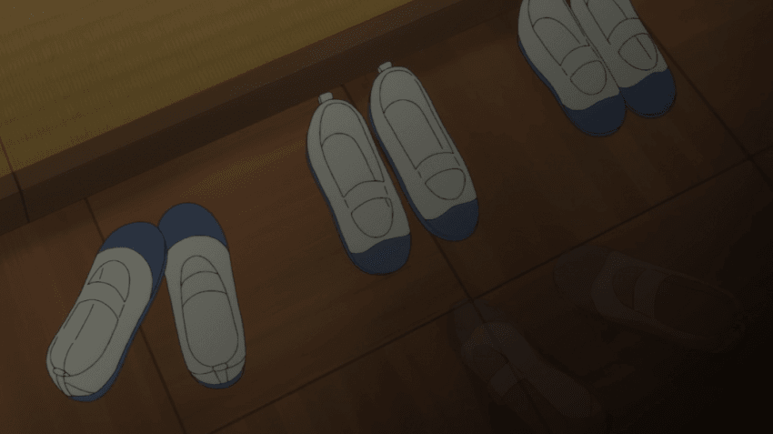
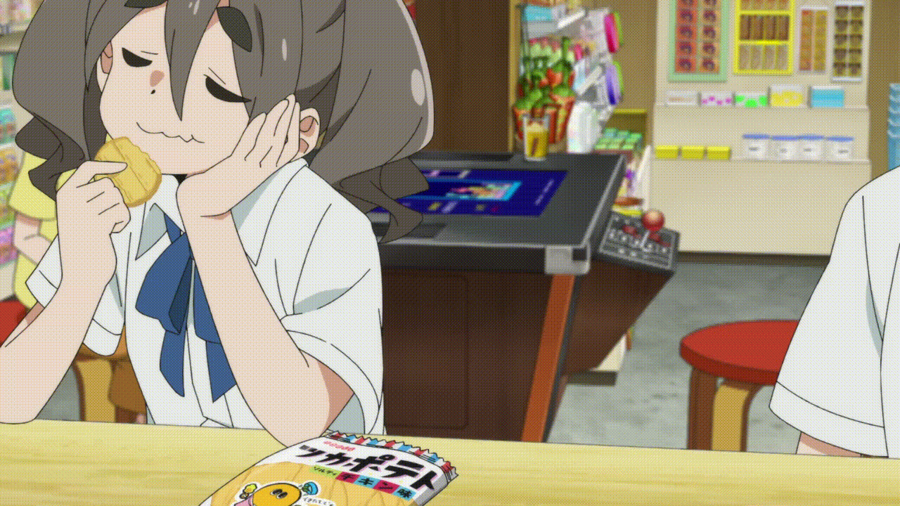
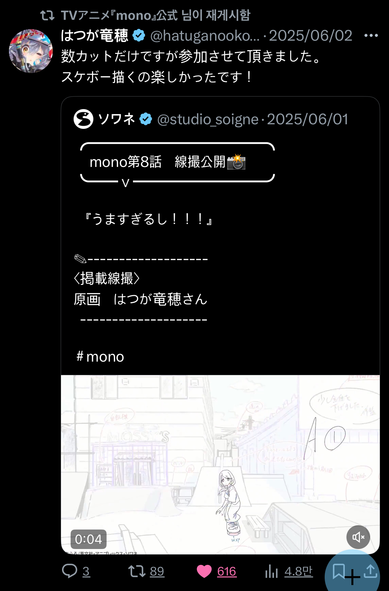

The original text is in Korean, and this translation was produced by ChatGPT.

https://youtu.be/OssMWb7KIO8

“Nichijou-kei” seems to be changing still. These changes can hardly be reduced to a single current, but think of older names—《Hidamari Sketch》, 《K-On!》, 《Strawberry Marshmallow》—and then of 《Bocchi the Rock!》, 《Onimai》, 《Stardust Telepath》. It is hard to deny that something has changed. Yoon Eun-ho describes the new form of “nichijou-kei” that appeared in the late 2010s as “anime that, while maintaining the grammar of nichijou-kei anime, faces reality with a ‘feeling of living toward the earth’ (大地に目指して生きてる感じ) on the basis of a specific theme and regional background” (Yoon Eun-ho, 2021). One of the central works in this development is, of course, 《Yuru Camp△》.

After the late 2010s—the closing years of Heisei—the early 2020s saw 《Bocchi the Rock!》, 《Do It Yourself!!》, 《Yama no Susume Next Summit》, and 《Onimai》 air in succession. These works seek to bring out each animator’s individuality, and thus I would like to call them a new form of “nichijou-kei sakuga anime” or “auteurist nichijou-kei anime,” distinct even from Kyoto Animation’s nichijou-kei anime.

These two currents hardly account for every change in nichijou-kei, but they do seem to be two sides of 《mono》. Yet 《mono》 resists being read as merely 《Yuru Camp△》 given a Reiwa makeover, for better or worse. The reason is that it seeks to present reality, rather than re-present it.

## Introduction ― Nichijou-kei Works That Re-present Reality and 《mono》
I like calling nichijou-kei a closed circle. Consider, for example, 《Hidamari Sketch》: in the quiz event “Hidamari King Championship,” where the winner’s prize was the fulfillment of a wish, the winner’s wish was not any personal desire, but the production of a fourth season. The ending of 《K-On! The Movie》 seems to hint at “Azunyan’s graduation trip,” which will probably never be depicted, and to say that their relationships will remain unchanged forever. Thanks to this, they graduated from Sakuragaoka, but readers still have not graduated from 《K-On!》. A circle means that even if one leaves 《K-On!》, one returns there again. They became trapped in the closed, fictional everyday life created by 《K-On!》.

Nichijou-kei as Perky Pat, which confines readers in a fictional closed circle, or lets them escape into it, has often been criticized. In *The Imagination of the Zero Years*, Uno Tsunehiro affirms “kuuki-kei” 空気系 as a possible way beyond sekaikei, but he still draws a line, saying that the world depicted by “kuuki-kei” works such as 《Lucky☆Star》 is, “at the present point, no more than an everydayness blessed within the range in which male users’ desire for ‘possession’ is guaranteed (...) a ‘moe’ supplement.” Even so, in “Maternity Dystopia EXTRA” and *Lectures on Subculture for Young Readers*, he evaluates nichijou-kei, especially 《K-On!》, positively, characterizing it by placelessness, timelessness, and idealized everydayness. The timelessness of nichijou-kei that he names is “resistance to, or exclusion of, the temporal movement of giving birth to children, raising them, and dying.” Whether this “timelessness” is truly timeless is questionable, but in any case, this exclusion still remains an important feature of nichijou-kei, and becomes the focus of a common criticism surrounding nichijou-kei.

Yet the new nichijou-kei of the late 2010s has weakened both the account of the genre as placeless and the account of fan pilgrimages as inserting new meaning into “ordinary places”. Such nichijou-kei works, instead of depicting anonymous streets that might exist anywhere, re-present places with regional specificity that exist only there. A fan pilgrimage to the locations of these works is not the overwriting of ordinary places with fiction, but the (re)discovery of the charm of special places through the medium of fiction. As the circular world of nichijou-kei re-presents reality, even if the reader is trapped there, they still face toward reality. Consider the Yuru Camp Minor Gallery forum, which has become almost entirely a camping community.

One might borrow Uno’s expression and call this the defeat of fiction ― manga and animation ― by reality ― YouTube. But fiction has never been defeated by “reality.” In *What Is a Shot?*, Hasumi Shigehiko criticizes André Bazin, who tries to make film close to “reality,” and says, “the cinematic reproduction of an image once it has been shot (...) is only being ‘represented’ with a certain cleverness, and is by no means ‘reality’ itself.” Even without citing the countless others who make the same claim, everyone already knows how far YouTube videos are from “reality.” Rather ― as the work critical of YouTube 《Food for the Soul》 points out ― YouTube videos also resemble the new form of nichijou-kei in the late 2010s. Here, the places or products introduced by YouTubers become the objects of “fan pilgrimage.” YouTube videos and nichijou-kei probably stand in the same relation as documentary and (fiction) film.

In that sense, the fundamental difference between YouTube and nichijou-kei is that YouTube gives the impression that the image shown is reality, while manga and anime do not. In other words, the new form of nichijou-kei in the late 2010s is, after all, a “re-presentation” of reality.

For example, the Yamanashi of 《Yuru Camp△》 is a fictional space that reproduces our world’s Yamanashi quite faithfully, and in that space fictional protagonists camp or make campsites. Here, the realism of 《Yuru Camp△》 is realism only in the sense that real landscapes have been transferred into precise background art. 《Yuru Camp△》 can be “yuru”—laid-back— because its entirety is as fictional as the exaggerated flashback scenes in episode 7 of 《Yuru Camp△ SEASON 3》.

In this situation ― as the episode title already indicates ― the self-reference in 《mono》 episode 1, “The Journey of mono,” and the protagonists’ club, “cinephoto,” place 《mono》 somewhere entirely different from the circular world of nichijou-kei. Let us see how.

## 《mono》 as Essay Manga
“Sorry, I forgot to mention it!! Please make it a manga with high school girls as the protagonists!!”  
→ “Understood, I’ll try.”  
“It might get a good response if there’s a food element too!!”  
→ “Food manga does sell well these days!”  
“And it would be good to have a local flavour.”  
“Since you live in Kofu, how about setting it in Yamanashi?”  
→ “Sounds good! I’d like to put a cat in as a mascot, too!”  
“Since the cat was the protagonist of your previous work, let’s leave it out.”  

After finishing the serialization of 《Take the Cat and Go Just a Little Ways Over There》, Haruno consults with her editor about drawing a four-panel manga about high school girls. The ending of episode 1 shows the storyboard for that four-panel manga, modeled on Satsuki and An. That storyboard points to the first few scenes of 《mono》 itself. The editor’s tsukkomi about that storyboard, “You slipped a cat in there, though,” is subtly connected to the next scene, where Satsuki finds that very cat, Taisho, on the street and films it with a 360-degree camera. In the end, the ending turns episode 1 of 《mono》 inside out, revealing the story of Haruno herself up to the serialization of 《mono》, and the Kirara-like story of Satsuki and An “drawn by Haruno.” Moreover, this reversal is repeated every episode. Except for the first and final episodes, the last shot of every ending is a manga storyboard depicting a scene from that episode. The ending of 《mono》 is a [Koi-Kaze-like ending](/en/nichijou/koikaze_ed/) that “cannot be skipped.”

In the following episode 2, 《mono》 criticizes itself. Haruno’s thoughts, “The scenery seen in a photograph and the scenery seen in person really are different,” and “A manga that makes you want to actually go there. Yeah, that’s good!” are directed toward 《mono》, the manga she draws. And in episode 6, admiring the dedicated app for searching for round-stone Dosojin, in which seven hundred Dosojin are recorded, Satsuki self-deprecatingly says, “Wouldn’t it make a more interesting manga if we interviewed the operators instead?” Yet the episode itself already shows us what Haruno drew: not the app’s operators, but Satsuki and her friends’ not altogether successful search for Dosojin. No, rather, she cannot interview the operators. This is because Haruno wants to draw a manga that refers to herself and to Satsuki and her friends as she has seen them. These self-references make 《mono》 an essay manga. Becoming “more interesting” is not the goal of essay manga, and in this sense 《mono》 has criticized itself. At the same time, the self-reference of 《mono》 makes it, in principle, impossible for it to be a made-up essay manga by a made-up person. Of course, self-referential metatexts were already being actively created and criticized at least in the late twentieth century. Still, a reading of 《mono》 must begin from the fact that 《mono》 remains a Manga Time Kirara nichijou-kei manga/anime.

Because 《mono》 is essay manga, all the stories in 《mono》 belong to the past. The first scene of 《mono》 episode 1 only begins to be drawn when we reach the ending. Further, every story in 《mono》 is an event of the past, “already” drawn through Haruno’s adaptation of Satsuki and An’s experiences. “Wow, I was thinking, this is the kind of conversation writers whose works have been animated would have.” Haruno’s 《mono》 ― naturally ― has not yet been animated at the time of 《mono》 episode 7. Meanwhile, as John Fiske says in *Television Culture*, countless television serials are “stories which continue in a state of incompletion” and try to give “a sense of the future that goes with an unwritten text.” “The serial becomes so easily part of everyday life because its formal structure represents the immediacy, presentness, and unwrittenness of oral culture” (John Fiske, 1987/2017). Yet 《mono》 as a television anime serial brings to the foreground, from the very first episode and every episode thereafter, the sign that its own events belong to the past.

《mono》 relinquishes the presentness of the television serial; precisely because it does so, it is not timeless. “A camping manga set in Yamanashi that we’re serializing is getting an anime adaptation next spring; how about making the next chapter a story that also doubles as a visit to its locations?” Since Haruno is the author of 《mono》, serialized by Houbunsha, this camping manga can only point to 《Yuru Camp△》. The world of 《mono》 is a world in which 《Yuru Camp△》 exists as a manga. 《mono》 as essay manga “presents” reality inside itself. The fact that 《mono》 belongs to the past means, rather, that the events of 《mono》 are really engraved somewhere on the time axis of our world. Conversely, the timelessness of nichijou-kei presupposes an additional time axis. The protagonists of nichijou-kei are “living” somewhere on another time axis, and timelessness is the fact that whenever readers open/turn on the work, the origin and scale of that time axis are newly adjusted. 《mono》 bypasses the timelessness of nichijou-kei simply by including the marker that it depicts the past of our world. The temporality of 《mono》 is the temporality of photography: preserving the past that will not return, so that readers can continue to face that past.

In that sense, 《mono》 is a feeling of having “lived toward the earth,” and in that sense too, 《mono》 is a documentary that “filmed our world.” Therefore, the following two sections should be read in parallel with this one.

## One Auxiliary Line ― Wim Wenders, 《Tokyo-Ga》(1985)
“I can’t remember anything. I know I was in Tokyo. I know it was the spring of ’83. I know that. I was with a camera, and I shot images. These images now exist, and they have become my memory. But I cannot remember. If I had not had the camera, I might now be able to remember better.”  
《Tokyo-Ga》(1985) begins from this monologue by Wim Wenders. When Nam Soo-young wrote in 2009 in *Historical Memory in the Age of Images* that it was “not easy to figure out exactly what this monologue means,” Nam could hardly have foreseen that, within ten years, everyone would be going through daily life with a small camera, taking photographs. Now all of us can easily understand this monologue by Wim Wenders. In everyday life, our eyes are often replaced by smartphone cameras, and at tourist sites everyone worries less about how to remember better than about how to take better photographs. Has the problem Wenders felt in 1983 now become everyone’s problem?

《Tokyo-Ga》 also begins with the first scene of 《Tokyo Story》(1953). Wenders, who counted the films of Ozu Yasujiro as a sacred treasury of cinema, boarded a plane to Tokyo to confirm whether the image of Tokyo reflected in Ozu’s works still remained. Praising certain moments in Ozu’s films ― the gesture of a child in the background, the flight of a bird across the frame, the shadow of a cloud on the screen ― as “moments of truth,” he wanted to find the familiar image of Tokyo that he had felt in Ozu’s films. In a subway station, Wenders sees a child being dragged by his mother’s hand. The child brings to mind the rebellious children who often appear in Ozu’s films. Or, to borrow his expression, perhaps he wanted to recall them. But he again confesses, “Perhaps what I am looking for is no longer here.” Tokyo has changed, and perhaps the Tokyo of the 1950s no longer exists. Even so, Wenders sees Ozu’s Tokyo in the people and places he finds ― a stubborn child, a golf range, a Shinjuku alley seen with a 50mm lens, and a train. He feels an uncanny familiarity in these images. These feelings of intimacy coming from Ozu’s films interfere with Wenders’s vision. Or, in a better expression, “we read a text with prejudices, and prejudices determine our fore-understanding” (Hans-Georg Gadamer, 1960/2012).

“Only what exists exists, and that is the real and reality. There is no idea as empty and useless when applied to film as this concept. Each person knows for himself what ‘recognition of reality’ means. Each person sees his reality with his eyes. (...) And each person knows for himself the often enormous gap between personal experience and its depiction on the screen. Because we have learned to accept the enormous distance separating cinema and life as so natural, when we suddenly discover something real in a film — even if it is only the gesture of a child in the background, a bird crossing the screen, or a cloud casting a shadow on a scene for a very brief moment — we hold our breath and are startled.”  
Wenders speaks of skepticism about truth through Ozu’s films. Instead of Tokyo, he saw Tokyo through a camera, and 《Tokyo-Ga》 became his memory. Wenders’s Tokyo is neither the Tokyo of spring 1983 nor Ozu’s truthful Tokyo. Wenders came to Tokyo holding Ozu’s truthful images, but the Tokyo he saw was full of images that seemed empty: people obsessed with poses as they play golf, and fake food models. Yet Wenders says he wants to see them. 《Tokyo-Ga》 juxtaposes Ozu’s truthful images and seemingly empty images. This juxtaposition depicts “the extreme gap between experience and its depiction on the screen.” For that reason, paradoxically, Wenders’s Tokyo is Wenders’s own truthful reality. Documentary is fictional, as in his first monologue, but at the same time truthful.

Now let us read 《mono》 with 《Tokyo-Ga》 as an auxiliary line.

## The Camera of 《mono》 Is Ambivalent, or the Theme of 《mono》
At the start of the new school year, the photography club and the film research club, whose seniors had graduated and which had no new members, “coincidentally” faced the threat of being disbanded at the same time. And “coincidentally,” the president of the film research club was Shikishima-san, who had been in the same class as Satsuki, and Shikishima-san was “coincidentally” cool. The cinephoto club, a club formed by combining the photography club and the film research club, came into being through an accumulation of coincidences. And indeed, without coincidence, a photography club and a film research club cannot merge. The only commonality between photography and film seems to be that they are arts that use a camera.

“Since the cinephoto club is both a photography club and a film research club.”  
“That’s true.”  
“But haven’t we been shooting bits of video too?”  
“This time it’s not video, it’s film.”  
“Well, that makes sense.”  
Part B of episode 11 ends with a conversation in which the protagonists, facing the end of summer vacation, decide to shoot a film next term. In response to An’s question, “Haven’t we been shooting bits of video too?”, Satsuki answers that video and film are different. As An’s question suggests, video and film are both iconic in the sense that they resemble reality and point to reality. But as Satsuki points out, video is photographic, while film is not. As in the monologue from 《Tokyo-Ga》, we all already know the gap between reality and film on the screen. By contrast, photography possesses, at the level of the medium itself, the indexicality that the image reflected in that photograph really existed in the past. The viewer sees “that very” photograph taken by Satsuki and the others. Therefore, the viewer and the protagonists can share the same reality.

If there is something more realistic than this realistic (still) photograph, it is probably the 360-degree panoramic photograph and Street View. 360-degree photographs and Street View require our action, as if they were games. As An says about 360-degree photos, “it’s more fun to play around with them.” This scope for action is indexical. Like photographs, they are images of a past appearance and evidence that their objects existed in reality. Beyond that, the actions they allow are determined by how turning one’s gaze changes the actual view, and by which roads one can drive or walk along. Why not call them photographic sandbox games whose genres are turning one’s head and taking a walk? Because reality is already a sandbox game, or because they place “fewer restrictions” on the real landscape, a function on spacetime and the unit sphere, they are realistic.

Yet despite all the realism gathered so far, the virtual walk for the round-stone Dosojin search contest was only partially successful. The narrow alley that Street View could not enter; the Dosojin that was not round when viewed from the side; An found the Dosojin not in Street View but in a memory brought back when a cucumber sent flying by Taisho hit her. Finally, with just a few words, Haruno’s grandmother rendered useless all the information obtained through Street View and the internet. “Come to think of it, how about the round-stone god behind the house?” “It’s always been there.” That forgotten round-stone god placed Haruno second in the contest.

Or:

Episode 3 opens with the challenge of visiting the scenery of Mt. Fuji, Kurobe Dam, Super-Kamiokande, and the Metropolitan Area Outer Underground Discharge Channel through Street View duly completed. Then Satsuki complains, “Come on, taking the photos yourself is the whole point.”

As in the first monologue of 《Tokyo-Ga》, photography replaces something that could have been our “true memory.” The image in which experience has been recorded creates the illusion that the experience must have been like that image. Photography “blocks memory and thus becomes a kind of ‘counter-memory’” (Roland Barthes, 1980/1986). Or history is written in that way. This is a phenomenon experienced by everyone in the present age, and one theme of 《mono》 is precisely this universality. The many moments in which the protagonists of 《mono》 take photographs are not privileged moments. In 《mono》, taking photographs is already woven into everyday life. Satsuki’s Vita makes a shutter sound unlike a shutter sound, and photographing Dosojin from a moving car is not taking a photograph for the photograph’s sake. Perhaps the protagonists of 《mono》 habitually took more photographs than club president Potte of the 《Tamayura》 series, but these acts of photography remain anonymous, concealed from the viewer’s notice. At the same time, 《mono》 keeps hold of the moments when this universal habit pauses, and in doing so offers a critique of photography. Beside the Hachibuseyama observation deck, Satsuki cannot move on to the next place, cannot raise her camera.... “Haru-san, may I look, just a little, just a little longer?” The extreme close-up showing Satsuki’s right eye captures Satsuki’s gaze itself, directed outside the screen.... “Yes.” Then seven seconds. Only hair fluttering. The protagonists simply look at the view before their eyes, movement and thought both suspended. We directly experience the time that flows there. This pure image of time[^1] inserted between narratives is a symbol of reality, of infinitude, which photography, 360-degree photography, video, and documentary cannot re-present; it is also the driving force of fan pilgrimage.

Thus photography, video, and documentary contain fictional stories to some extent. This is a criticism and at the same time not a criticism. Rather, because of this, truthful photography, video, and documentary, like Ozu’s films and Wenders’s 《Tokyo-Ga》, have the power to give history a beating heart and to change the attitude with which we live in the present.

“The construction work was beyond anything they could have imagined.” The narrator of the in-universe documentary 《Project WY: Kurobe Dam ∼The Men’s Challenge∼》 says this over images of men struggling hard. It follows a scene of the men talking, their faces impassive. The connection makes the narration seem to describe what the men themselves imagined. In other words, even this short documentary uses free indirect discourse. An crying while looking at a concrete transport bucket, Sakurako thinking of the men while watching hikers walk over the dam, Haruno unable to take even one spoonful of the dam curry she had looked forward to. The past of the dam “drawn” by the documentary’s free indirect discourse changed the protagonists’ attitudes. 《mono》 as documentary itself acknowledges documentary’s power. 《Project WY》 is therefore a truthful documentary. Meanwhile, it seems clear that all of this was impossible through the Street View of episode 3. In this sense, Street View that has merely been “shot” without any consideration is usually “only” a restriction of reality, while documentary restricts reality while often bringing something new with it. Let me repeat: 《mono》 is a documentary.

*《mono》, episode 12.*

The camera of 《mono》 is ambivalent. Four pairs of indoor shoes placed in the cinephoto clubroom; the cinephoto club calls Tajima-san, an absent “ghost member” with long orange hair who goes at her own pace, and ambitiously decides to shoot a POV horror film, a horror mockumentary. Three pairs of indoor shoes in the cinephoto clubroom; Tajima-san has already gone home, though. On Fukashiro Dam, the sequence of scenes in which they shoot a film begins from a film-shooting “documentary” accompanied by the narration of Satsuki and the others, excluding Tajima-san. This documentary soon becomes a “film” in front of the Dosojin model, and after Tajima-san, contrary to the agreement, runs toward the lake, a splashing sound is layered over a long shot showing Satsuki and An stunned, and it becomes a “documentary” again. “Sorry, I just remembered something urgent. I’ll head straight home by bus.” But after that, the protagonists never saw Tajima-san at school. Tajima-san was a plain girl with short black hair. “Then who in the world was that person who shot a video with us....” $3+1/2$ pairs of indoor shoes placed in the cinephoto clubroom; the three pairs of living shoes are juxtaposed with Tajima-san’s semitransparent, immaterial indoor shoes. Double exposure. “The ghost member Tajima-san whom we knew really vanished suddenly, as if she were a ghost.” Yet this commotion was a hidden-camera prank set up by Sakurako and Inomata, an alumna of the film research club who played the fake Tajima-san, and at the same time as this confession, all those scenes became “film” again. In the end, was the video shot by the protagonists film or documentary? Probably choosing one of those two as the correct answer would be like saying light is either a particle or a wave. This question may not have any meaning: Ozu’s films and 《Tokyo-Ga》 have taught us that film and documentary each contain the properties of the other. Therefore, we must suspend the task of answering this question. Or call that image cinephoto.

## 《mono》 as Cinephoto
What pierces through that cinephoto and exposes fiction is Sakurako’s contradictory description of Tajima-san. There is something like that in 《mono》 as documentary as well. It is sakuga.

*《mono》, episode 3.*

One medium through which 《mono》 conveys its documentary truthfulness is sakuga. For example: in two consecutive shots of episode 3, a mischievous child stealing sweets, cutting across the space behind the protagonists as they discuss what to photograph in Haruno’s candy shop. The action camera overtaking its subject, An riding a skateboard, or showing the bushes and asphalt. The swaying trees passing behind Satsuki and the others as they film in 360 degrees while riding the panorama lift. The mirage in which the movements of the protagonists walking the Yamanashi shaved-ice pilgrimage route are reflected. These passages of animation recall the moments of truth that Wim Wenders found in Ozu’s films. Of course they do. The human eye is drawn to movement, and individual shots in anime contain little of it. These movements therefore become the protagonists of their shots. Their movement triggers memories of the periphery, of what lay outside the centre of our vision—for surely nothing could be as true as memories like these.

{: .half}

*X, @mono_weekend.*

On the other hand, the sakuga of 《mono》 is auteurist. 《mono》 is within the current of nichijou-kei sakuga anime. Everyone can sense this naturally, partly because of the official X account of 《mono》. The point is that when we scroll through the official X account of 《mono》, we encounter reposts of reflections and celebratory drawings by people involved in the production, and above all, the key animation posted by Soigne and the names of the animators who drew that key animation[^2]. Key animation, as the blueprint of movement or of animation, includes rough drawings colored in a few colour-coded markings and numbers indicating a drawing’s position in a movement. In other words, in key animation we see symbols related to the outside of animation, to animation “production.” Also, because key drawings also depict what lies outside the frame, we feel that the images drawn in the key animation are the whole of that world. Outside the key animation, there is the name of the key animator. Between animation and its end, there are ending credits. On the cover of the manga 《mono》 there is the name of Afro. Here, we are confronted with the fact that 《mono》 was created by someone. The sakuga of 《mono》 now weakens the documentary force of 《mono》 between the animation and its end. It opens a hole in the documentary. By revealing the name of Takahashi Yuichi instead of An riding a skateboard and the periphery around her.

Therefore, we should call 《mono》 cinephoto.

## The Ghosts of 《mono》
In a different context, another factor that makes 《mono》 cinephoto is ghosts. This sentence sounds like a tautology....

There are three ghosts in the anime 《mono》: (1) the ghost of a girl who attached herself to Haruno at Yashajin Pass, (2) Kurokuma’s assistant, and (3) Kurokuma encountered in front of the single pine tree of Nanamagari. The others are things the protagonists imagined seeing. Yet viewers find them boring above all because these ghosts were shot like Tajima-san’s indoor shoes, by double exposure. That is, whether the ghosts “really” exist or not does not affect the protagonists’ route. For example, the protagonists see the ghost of the girl only in the video, but even if the ghost does not exist, something that “looks like” a ghost might appear in some video. This double exposure means that 《mono》 has been somewhat adapted by Haruno. And this is exactly the method of making spirit photographs. 《mono》 is a spirit photograph, and the spirit photograph is already cinephoto.

《mono》 as documentary is a spirit photograph that is only animation. Spirit photographs are certainly uncanny, but before that, photographs themselves are already uncanny. As Yoo Woon-sung writes in *The Temptation of the Vegetal*, following Roland Barthes, “the more a photograph is functionally committed to factuality, as in press photography, the more its subjects seem, on closer inspection, to conceal all manner of stories; the more it is functionally committed to fictionality, as in advertising photography, the more its subjects expose, unguarded before the viewer, the factual features clinging to their faces and bodies.” Spirit photography merely brings that uncanniness to the center. It willingly gives up strong indexicality so that its uncanniness can create the “impression” of offering indexical evidence for ghosts. For what purpose did 《mono》 become a spirit photograph? Or, conversely, should ghosts have been removed from 《mono》?

I hastily called the ghosts of 《mono》 double exposure, but in fact there is a profound difference between double-exposed images and the ghosts of 《mono》: these ghosts are opaque. Or, the author of 《mono》 draws ghosts as real beings with bodies. Put differently, the protagonists and the ghosts are placed on the same ontological level.

As the viewers’ lukewarm response to the ghosts suggests, modern people who seriously believe in ghosts are an endangered species. In the same context, are there really otaku who seriously believe that the protagonists of 《mono》 and 《Yuru Camp△》 live in Yamanashi? But even while not believing in their existence, otaku follow their routes as if they had been there. Otaku envy those who have successfully reproduced and recorded their routes, giving them upvotes and front-page recommendations. But is this not precisely ― ideology, there are many names, but above all ― a ghost?

《mono》 seems to go one step further here. 《mono》 itself truly manifests its protagonists here as ghosts. The self-reference that makes the protagonists ― at least their models ― be here, and the ending credits (ⓒあfろ／芳文社・アニプレックス・ソワネ), contradict each other, so neither can be believed unconditionally. In short, we discover the protagonists inside 《mono》 as documentary, just as Satsuki and An discover the ghost attached to Haruno inside the action-camera footage. This is also why the protagonists of 《Yuru Camp△》 were inserted subliminally, and why 《mono》 presented itself as a spirit photograph. For those who will go to meet their ghosts, 《mono》 played the prank of releasing ghosts into Yamanashi.

The girl ghost attached herself to Haruno because she “was happy, since Haruno looked like the bird she had kept when she was alive.” To persuade the ghost to leave, Haruno, following Kurokuma’s advice, rides a bus through the tunnel of Yashajin Pass and silently murmurs, “You must have been lonely in the mountains; I will come visit from time to time, so this time please....” Haruno passing through the tunnel, “See you again,” and a sequence of bird’s-eye shots in which the viewpoint rises and shows the bus growing smaller and smaller. As though the ghost had finally passed on.... A small but profound, playful reversal: on the way back, as soon as Haruno passes through the tunnel again with a light heart, that ghost is attached to her again. Whenever Haruno passes through that tunnel again, the ghost will cling to her once more. And so will the ghosts of 《mono》.

## A Documentary of “Nichijou-kei,” Notes Toward Meta-Nichijou-kei
I declared too hastily above that 《mono》 is a documentary, but we must not stop here. We need to press beyond that obvious fact: if 《mono》 is a documentary, what is it a documentary of?

Various theories of photography, including Susan Sontag’s writing that photography is “shot through with pathos” (Susan Sontag, 1977/2005), emphasize that photography is a sign of absence. The beginning of 《mono》, Satsuki feeling lonely at the graduation of Makinohara-senpai, and episode 2, Sakurako recalling the film research club seniors who have left while watching Satsuki and An discuss how to take better aerial footage, seem to respond to this. As with 《Tamayura》, it cannot be denied that 《mono》 begins from the loneliness of absence. Yet unlike 《Tamayura》, Makinohara-senpai’s absence is not explicitly shown between the opening two episodes and the finale. Makinohara-senpai appears only briefly, in episode 3, as the lock screen when Satsuki checks the time on her phone, inserted among ordinary shots. 《mono》 is not photography, and above all it is animation that merely includes the taking of photographs. In short, except for the first and final episodes, the photography of 《mono》 is photo-“taking,” and therefore present tense. What viewers see is not photographs, but rather the images projected into the camera at the very moment of taking photographs.

The photographs of 《mono》 are past tense only in the final scene where Satsuki reunites with Makinohara-senpai. But this reunion is not a return to the time before Makinohara-senpai’s graduation, to the first scene. Satsuki’s words following the photographs shared with Makinohara-senpai: “(...) I’m taking lots and lots of photos and videos. So right now, I’m having so much fun!” The image that accompanies this is not a photograph recalling past events, but a moving image forming in Satsuki’s camera as she is about to shoot in 360 degrees. “I want to film all kinds of things!” The tense of 《mono》 is present. This is all the more so in that even while Satsuki looks at past photographs, instead of feeling wistful, she merely speaks of the state represented in those photographs that continues up to the present. Even if 《mono》 began from the loneliness of absence, it ends with the joy of existence ― which every nichijou-kei seems to want to depict. Therefore, let us call 《mono》 a documentary of nichijou-kei. This duality of tense of nichijou-kei and documentary resonates with 《mono》’s axis of cinephoto = ghost.

As Hirose Masahiro pointed out in “The Prison Called ‘Kuuki-kei’: The Anime 《K-On!》 and the Imagination Surrounding Sex” (2013), while insisting that 《K-On!》 is not “kuuki-kei,” nichijou-kei is not something like a “paradise” of girls from which conflict and time have been castrated. Rather, nichijou-kei is an attempt to depict a new form of growth. This growth is not the conventional shōnen-manga-like declaration of having escaped / intending to escape from moratorium ― an extremely Japanese word ― but a microscopic movement forward, quietly hidden within memories and experiences, loves and friendships. These are gathered under the single, vastly encompassing word “everyday,” yet are in fact irreducible. In 《Tamayura》: “Within unchanging days, something changes little by little. The time that has passed cannot be turned back, but precisely because of that it is precious and I do not want to forget it, so I keep it in my heart as memories.” Thanks to this, when one looks back at the protagonists as they were in the first episode from the final episode, even though their awakening or rite of passage has not been made visible and drawn through major conflict, one can sense a feeling of growth. Perhaps this automaton—making us look back through countless episodes whose events we cannot remember, toward the past at their far end—is what generates nichijou-kei’s peculiar nostalgia. But this distinctive mode of storytelling also produces the structure of a closed circle that, after seeing the final episode, makes the otaku head back to the first episode and makes it hard to escape. Thanks to this, nichijou-kei has received much criticism ― including the stigma of timelessness.

But meta-stories that explicitly block the phenomenon of “watching it all over again” allow us to imagine beyond it. The friends of the 82nd Student Council in the final part of 《Gakuen Utopia Manabi Straight!》 who stop and encourage Mikan as she tries to return to the romantic Seioh Academy, 《Revue Starlight》 which cuts off the closed repetition of the 99th Starlight produced by Nana, and so on. And now, 《mono》 as well. What, in the end, did 《mono》 leave behind? Pranks and ghosts, a will not to return to loneliness, and, in a certain sense, small arts of the everyday that may be called microscopic resistance ― to be transmitted through fan pilgrimage.

Like Satsuki, who set Makinohara-senpai’s photograph as the lock screen of her phone, we will keep 《mono》 as the wallpaper of our phones; we will also wander around Yamanashi along their routes in order to find the ghosts of 《mono》, and trade secondhand goods to pull SSR Haruno. But just as 《mono》 did, we will not return to the loneliness of the first episode. Just as Satsuki happened to meet Makinohara-senpai again beyond the screen, we will someday happen to meet 《mono》 again. And following 《mono》, which is meta in its own thoroughly laid-back way, we will say this: “After senpai graduated, I did feel down, but Kiriyama was there, and after I bought a new camera I met Haru-san too, and then we merged with Sakurako’s film club and became the cinephoto club. I also got to know Haru-san’s friends and colleagues in the industry. I even became a model for the manga Haru-san drew, and I’m taking lots and lots of photos and videos. So right now, I’m having so much fun!”

[^1]: These direct images of time are not special, but images common to nichijou-kei anime. For example, the fifty-second close-up in episode 4 of 《Non Non Biyori》 that holds silently on Renge’s face as her mind goes blank.

[^2]: As suggested by Kutsuna Kenichi’s distinction, proposed somewhere, between saku-ota, sakuga otaku, and sakuga enthusiasts, the saku-ota phenomenon could not have existed without social media.
