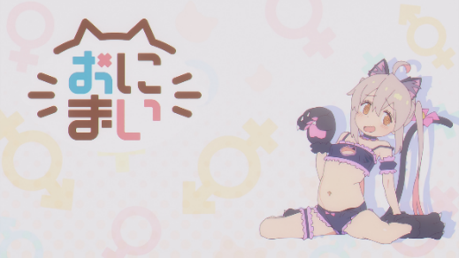
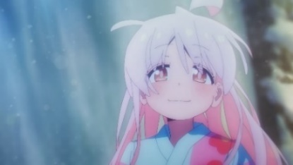
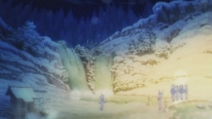

The original was written in Korean. This English translation was produced and revised with ChatGPT.

As the SF mecha and moe of 『Neon Genesis Evangelion』 once were, as the fighting bishōjo of 『Saikano』 once was, 『Onimai: I’m Now Your Sister!』 is the romantic dream of the “weebs” of our age. Yet any attempt to make sense of this hazy longing encounters questions with several dimensions. 『Onimai』 keeps oscillating among nichijou-kei, lolicon anime, and TSF, producing images that belong exclusively to none of them. It continually draws the viewer into participation. As the elements of these genres become entangled, the longing takes root of its own accord within the viewer. Following the protagonist Oyama Mahiro’s path of anti-growth, I want to uncover the spirits of the age concealed within the TV anime 『Onimai』.

## Introduction
It is clear that the TV anime 『Onimai』, which aired in the first quarter of this year, provoked an enormous—and strangely elusive—response from the moment it began. Perhaps this was because the eroticism of loli and TS, long relegated to the taboo domain of erotic manga, had entered the public sphere; or perhaps it was thanks to the “sakuga aesthetics boom” produced by 『Bocchi the Rock!』, 『Chainsaw Man』, and other works that had just finished airing. Yet the attention and commercial success of 『Onimai』, which slips away both from the grammar of nichijou-kei and from that of Japanese TSFTrans–Sexual Fiction, must in itself have a significance particular to its time.

## 『Onimai』 as a “Non-Everyday” Nichijou-kei Anime
In nichijou-kei manga and anime, eros is completely castrated despite the formal structure of their cast. Men are completely excluded from the space of bishōjo, and readers become a gaze, doing nothing but contemplating the characters’ lives. Even the ubiquitous fan-service scene is usually presented matter-of-factly. Nagayama Kaoru, in *Ero-Manga Studies*, describes Barasui’s nichijou-kei manga 『Strawberry Marshmallow』 as a “state in which desire and impulse have been suspended,” as “eros concealed and rendered unconscious.” In this sense, it should, paradoxically, be understood as a perverse commodity[^1].

Yet in 『Onimai』, sexual desire is displayed without restraint, as is already apparent from the blatant close-ups in the opening and the depiction of water running over the school swimsuit. Moreover, the long bath scenes in episodes 2 and 8 may be called experiments at the limit of eroticism in TV anime. Bath scenes frequently appear even in nichijou-kei anime such as 『Hidamari Sketch』, but they have not shown this degree of insistence on friction between wet skin or on character animation in the bath[^2]. The bath scene in nichijou-kei is, on the surface, literally only the depiction of an “ordinary act of bathing,” and explicit eros does not appear. The wildly shaking, realist “sakuga-image” of 『Onimai』 revealed the eroticism of animation as such.

{: .half}

*A scene from the storyboard of 『Onimai』 episode 1. Mahiro’s nude-image is visually severed by the hand. The realistic animation in this shot carries the possibility of undoing that severance.*

Here, 『Onimai』 deviates from the nichijou-kei genre. Yet this is not an escape from genre. It is rather an opening-up of the desire hidden within the genre. In other words, the erotic images of R-18 yuri fanfiction devoured by refugees from nichijou works have moved into the surface layer ― TV anime. That is, 『Onimai』 is the projection of the “non-everyday” desire of viewers who are refugees from nichijou works into nichijou-kei anime.

## 『Onimai』 as Lolicon Anime
Elements born in erotic manga or derivative works often spread into the “daylight” of the mainstream, but what happened in 『Onimai』 ― precisely because 『Onimai』 is a TV anime ― requires another genealogical interpretation. This concerns how erotic depictions of loli, treated as taboo since the early 1990s, could appear in the medium closest to the public: TV anime.

As with 『Kodomo no Jikan』, the first bishōjo anime to depict loli eroticism, TV lolicon anime ― though there are not many of them ― has tried to convey an idea through its examination of the relationship between children and adults. 『Kodomo no Jikan』 exposed the boyishness of adults and the young-adult qualities of children that emerge within that relationship[^3], 『Today in Class 5-2』 brought out children’s maturity through the visual shorthand of a gekiga style, and by 『Fate/kaleid liner Prisma☆Illya』 it had come to praise the “loli” as a being superior to adults. Does this detour appear out of guilt about undressing children, or fear of the public’s hostile gaze? In any case, TV anime that depict loli sexuality have explicitly sought, from within their own narratives, to escape being “devices for pleasure.”

By contrast, 『Onimai』 offers no excuse for depicting the naked body of a middle-school girl. The scene in which Mahiro and Mihari take off their tops, wash their hair, enter the bath, and get out is depicted only within the grammar of nichijou-kei, “whose contents one forgets after watching.” This meaninglessness is heightened still further in the overt eyecatches rendered through realistic character animation.

{: .half}

*The eyecatch of 『Onimai』 episode 2. It depicts Mahiro in a perverse outfit that does not appear in the main episode.*

Above all, there is probably no viewer who could extract an unequivocal moral from the scene in the latter half of episode 12, where Mahiro feels that it has been a long time since she had a snowball fight with friends and chooses to remain a loli. Instead, only the peculiar gap between the “Big Brother Remodeling Project” and the deliberately romanticized “remaining a loli” makes possible the viewer’s creation of meaning.
{: .no-indent}

## Nichijou-kei–TSF and the “Big Brother Remodeling Project”

Ultimately, the questions surrounding 『Onimai』 lead back to the “Big Brother Remodeling Project.” According to Nagayama Kaoru, “cases in which the transsexual subject directly chooses a female body are very rare; in most cases, the transformation is a forced sex change through violence or threats, [...] or else it occurs through deception.[^4]” In short, causing a sex change in order to treat a hikikomori is not something that happens in ordinary TSF. At this point, 『Onimai』 even feels like “biotechnology SF.”

The problem of hikikomori is often discussed alongside otaku; the analogy is sometimes taken so far that the two are treated as one and the same. As depicted in the latter half of episode 1, the protagonist Oyama Mahiro, “a proud, solitary guardian of the home who loves eroge,” became a hikikomori due to the pressure of being the older brother of a genius younger sister and so on. To that extent, he is designed so that today’s male weebs can readily inhabit his position.

Meanwhile, Mahiro’s course through the Big Brother Remodeling Project follows the structure of TSF, as each episode title indicates. The male viewer’s gaze identifies with the protagonist, even as the protagonist experiences life as a woman. 『Onimai』 develops this further through the grammar of nichijou-kei. After 『K-On!』, at least by the late 2010s, one task of many nichijou-kei works was to “add one line to the reader’s bucket list”[^5]. This is also the context for 『Onimai』’s depiction of a hikikomori becoming a girl.

“[...] But actually, right now I feel strangely at ease. It feels like I’ve returned to a place that suits someone like me. Maybe I should just call it quits as a big brother and stay this way...” Mahiro’s falling (absorption), which begins from this monologue in the latter half of episode 1 as he recalls himself becoming a hikikomori, continues along a nichijou-kei path: buying a bra, learning how to wash long hair, having trouble holding in urine, and so forth[^6]. While the weeb viewer lives through this falling (absorption) along a nichijou-kei path, the romantic longing epitomised by “I want to become a loli too” finally comes into being (just as it did with 『K-On!』).

In the final episode, during a hot-spring trip with everyone, the effects of the “medicine that turns one into a girl” suddenly wear off and Mahiro begins to return to his original form. To prevent a disaster, Mihari offers him an extra dose, but if he takes it, he will not be able to return to his original form again for some time. Faced with the choice between adult and child, Mahiro chooses for himself to remain a loli. At the same time, when Mahiro, addressed as a loli, smiles and runs into the arms of his friends, the adult hikikomori Mahiro, whom no one addresses, is thoroughly sublimated. In that close-up, when the light effect softly illuminating just above Mahiro and the delicate animation alternating between drawings held for three frames and for two romanticize the whole scene, the viewer’s vicarious experience of this sublimation erases even the viewer as hikikomori at that instant. On the snowfield, only children remain, laughing and playing.

{: .half}

{: .half}

*A scene from 『Onimai』 episode 12.*

## The Anti-Growth of the Hikikomori and Lolicon Anime
And so, at the end of 『Onimai』, Mahiro does not become an admirable older brother. He chooses instead to refuse maturation. Aboard the train bound for Oonimai Station (逢二妹駅), Mahiro and the viewer travel toward anti-growth.

Anti-growth is not the opposite of growth; it is a refusal to become a “coming-of-age story.” Any conception of growth’s opposite, whatever form it takes, necessarily carries the metaphysics of growth with it. But within anti-growth, the structure of the coming-of-age story—in which boyhood, through a certain effort, crosses a symbolically marked rite of passage and leaps into young adulthood ― is dismantled, and the protagonist is liberated from the binary opposition of boyhood/young adulthood, and from the myth called “growth” that urges one to become an adult. In short, TV lolicon anime, in which children and adults become entangled, should be read precisely as anti-growth narrative. 『Onimai』 as lolicon anime also depicts anti-growth by dismantling the binary opposition between Mahiro’s “inside,” which has become adult, and Mahiro’s “outside,” which has become a loli. The hikikomori has the boyishness symbolized by “the younger sister’s toy,” and the loli possesses maturity, as Mihari proudly says, “Maybe the Big Brother Remodeling Project has produced results beyond expectations~.” But within the conventions of nichijou-kei, the “Big Brother Remodeling Project” is neither immediate nor discrete. No one urges Mahiro to grow. There, Mahiro is remodeled without even knowing it.

Perhaps not as abruptly as for Mahiro, who almost became an adult in the hot spring, but the moment of becoming an adult comes suddenly to everyone. Having become adults with no preparation, we wander through our respective societies, still carrying our boyishness with us, still trembling with anxiety. The hikikomori youth, a shut-in with anxiety disorder, likely arises within this context. If we tell people who lack even everydayness that they can truly exist only by overcoming anxiety or suffering, and urge them to go outside, would it sound like anything but some overbearing elder’s bullshit?

『Onimai』, conversely, coaxes its hikikomori viewers through an experience of anti-growth, drawing on the romantic longing of the weebs of our age. To count Mahiro’s choice to remain a loli—after having been dragged along everywhere—as “the success of the Big Brother Remodeling Project” is to celebrate a movement away from anxiety, a falling into the world of nichijou-kei. This depiction suggests that existential philosophy, or the model of the subject, can no longer diagnose the modern problem represented by the hikikomori.

What alienated people born on the far side of war ideology need is not a resolve to leave everydayness behind and become a hero. What is called for is a new existential philosophy that seeks to recover a lost everydayness, to excavate the forms of authentic existence entangled within it. This work now takes place in popular culture rather than philosophy. 『Onimai』, casting off its clothes and “becoming-loli,” has taken that first step alongside the viewers who identify with it.

“I am, we are, Mahiro-chan” (俺が、俺たちがまひろちゃんだ)[^7].

## In Place of a Conclusion
The products of otaku culture that become the subject of criticism ― not research ― are diverse, but “animation criticism,” at least here in Korea, seems in most cases to remain confined to “animated films.” In other words, animation criticism functions as film criticism, not as criticism of otaku anime. As a result, while the finely detailed depiction of meals through a variety of shots in 『Your Name.』 drew attention, Okiura Hiroyuki’s realist character animation that breathes life into running, or Hashimoto Takashi’s splendid explosion-effect animation, were forgotten.

As several recently released films show, interest in Japanese animation in Korea is increasing. Whether or not it approaches animation as painting in motion, I hope for a richer animation criticism: independent of film criticism, working with animation’s own vocabulary, and written for otaku. I hope, too, that a space for it will take shape.

[^1]: Nagayama Kaoru. *Ero-Manga Studies* (Seon Jeong-woo, Trans.), 334-338. AK Communications. 2022.

[^2]: Character animation in nichijou-kei anime began to receive attention again at least after 『Yama no Susume Third Season』. This tendency continued afterward in 『Bocchi the Rock!』, 『Yama no Susume Next Summit』, 『Do It Yourself!!』, and others, leaving a modest but unmistakable mark. Among them, the commercial successes recorded by 『Bocchi the Rock!』 and 『Onimai』 were enough to change the terrain of nichijou-kei anime. Despite the analogy, I believe that “nichijou-kei sakuga anime” will become a new horizon for nichijou-kei anime.

[^3]: 『Kodomo no Jikan』 is clever. The conflict depicted among an elementary-school teacher, elementary-school students, and guardians is, at a glance, erotic, but at the same time socially critical and didactic. I have therefore read 『Kodomo no Jikan』 as a work that dismantles the adult-child dichotomy presupposed by coming-of-age stories in general. This is why 『Kodomo no Jikan』 was able, as a TV anime, to depict loli eroticism for the first time. All lolicon anime aired after the success of the 『Kodomo no Jikan』 experiment probably owe a certain debt to it.

[^4]: Nagayama Kaoru. *Ero-Manga Studies* (Seon Jeong-woo, Trans.), 321-323. AK Communications. 2022.

[^5]: Yoon Eun-ho. A Study on Changes in Nichijou-kei Anime in the Late 2010s. *Cartoon and Animation Studies*, 65:97-125, 2021.

[^6]: It is difficult to view Japanese TSF entirely from a queer perspective. In TSF, men and women are divided into a binary through their gender roles, and its narratives mainly depict the protagonist who has undergone sex change adapting to, or “falling into,” the opposite sex.

[^7]: Hiroyama Hiroshi, X/Twitter, [https://twitter.com/hiroshi_/status/1690608396394024960](https://twitter.com/hiroshi_/status/1690608396394024960).
